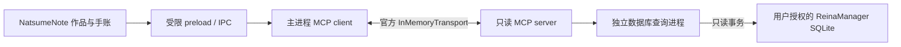

# NatsumeNote × ReinaManager 游玩记录 MCP 与标签交互方案

日期：2026-10-21。状态：设计稿，尚未实现或连接真实用户数据库。

**目标**：NatsumeNote 能读取 ReinaManager 中作品的已保存游玩时段、计时时长和累计统计，并在作品档案及手账中明确展示来源；完善作品标签的展开和筛选。

**架构**：在 NatsumeNote 内新增只读 ReinaManager 数据适配器，由 MCP server 提供有限查询，NatsumeNote 主进程作为 MCP client。首版使用官方 SDK 的进程内 transport；所有新增文件、命令工作目录和后续实现都在 NatsumeNote 中。

**技术栈**：沿用 Electron 31 / React 18 / TypeScript / better-sqlite3；实施时新增并锁定兼容当前 Node/Electron 的官方 `@modelcontextprotocol/sdk` 及其要求的校验依赖，以 SDK 协商协议版本。不得自行模拟 MCP 协议。

## 1. 事实、需求与边界

证据及原始行号见 [源码证据](../../reina-mcp-source-evidence.md)。协作任务见 [DeepSeek 提示词](../../reina-mcp-deepseek-prompt.md)。

- ReinaManager 是 Tauri 应用，当前查看的代码中没有现成 MCP server。Tauri 内部 command 无法由 Electron 直接调用。
- `game_sessions` 保存 session_id、game_id、start_time、end_time、duration、date。时间戳单位为秒，duration 是取整后的分钟；`game_statistics.total_time` 也是分钟。
- 原应用支持按前台有效时间或自然经过时间计时；历史会话行没有保存计时模式或手工记录类型。因此接口返回 `trackingMode: "unknown"`、`recordKind: "unknown"`，不反推。
- 累计时长不能用 end_time − start_time 替代。源库 date 在当前代码中按结束时间的本地日期生成；不能假定为开始日期或当前用户时区的日期。
- 只读数据库可读取已持久化记录；不能知道某游戏此刻是否运行，不能显示未经来源提供的实时计时。应用关闭仍能读取源库，但不能据此宣称它在线。
- 不改 ReinaManager，不修改其数据库，不把游戏存档、可执行文件路径等无关数据传进手账。音乐播放时长与 Galgame 游玩时长独立。
- 本轮交付设计和协作评审。应用代码、依赖、schema 和 EXE 均不变；实施和打包是后续任务。

## 2. 用户能操作的流程

1. 设置 → 数据连接 → ReinaManager → 选择 `reina_manager.db`。展示路径供核对，允许选择安装版或便携版的数据文件；不要硬编码 AppData 目录。源码显示便携版路径为 `<exe>/resources/data/reina_manager.db`，安装版为 `<system-data>/<identifier>/data/reina_manager.db`，开发版使用独立 identifier。
2. 点“测试连接”，只读取 schema 和少量目录信息。展示“数据库可读取 / 不支持此版本 / 文件不可访问 / 数据库忙”，而非笼统的“应用在线”。选择错误时不创建空数据库。
3. 进入作品 → 关联游玩记录。按 VNDB/Bangumi ID 推荐候选，展示两边标题、资料 ID、来源库简称；没有资料 ID 时提供名称搜索。由用户点“关联此作品”才保存，取消不改变现有绑定。
4. 作品档案增加“游玩记录”：累计记录时长、最近游玩、最近若干次起止时间和单次计时时长。显示“来源 ReinaManager · 上次读取 …”与刷新按钮。
5. 手账侧栏可查看当前作品的记录，用户选择后插入“游玩记录卡片”。插入是明确的本地写操作，查询不会自动改写手账。首版卡片保存当时的显示快照和来源引用，注明“截至 …”，不会静默跟随外部删除或刷新。
6. 断开连接后停止读取并清除可刷新的缓存；已插入卡片作为本地历史内容保留。删除本地作品遵循现有本地删除流程，永不联动删除 ReinaManager 游戏或会话。

首次连接是文件授权，作品关联是数据匹配，插入卡片是本地保存，三者分别确认，不共用“保存设置”总按钮来等待慢查询。取消关联/文件选择不导致错误提示。

## 3. 为什么用 MCP，以及它实际连接什么



MCP server 和数据库适配器由 NatsumeNote 托管，这是对现有 ReinaManager 的兼容桥接，不是修改对方软件的原生 API。即使首版不开放端口，也要通过 SDK 完成 initialize、tools/list、tools/call，而不是只给普通函数起 MCP 名称。渲染进程拿不到 MCP transport、Node 能力或数据库路径参数。

首版不依赖 AI 模型即可使用。未来同一 server 可增加供 Codex 等外部客户端使用的 stdio 入口；该阶段另做 Electron 无窗口启动、原生模块 ABI、退出和 stdout 协议隔离验证，未经验证不提供虚假的可用配置。未来如果 ReinaManager 官方提供 MCP/API，只替换 adapter，保留查询契约。

进程内 transport 不是跨软件实时通道；跨软件数据来自 SQLite。只读查询以外的绑定、选择文件、插入手账均走 NatsumeNote 自己的 IPC，不能由 MCP 查询工具绕过授权。

## 4. 查询契约 v1

以下为拟议接口，实施时用 SDK 的输入/输出 schema 严格校验。所有查询工具标记 `readOnlyHint: true`，但该提示不代替权限校验。返回 `structuredContent`，并提供简短 text 兼容结果。

| MCP 工具 | 输入 | 返回重点 |
| --- | --- | --- |
| `reina_get_connection` | `sourceId` | readable、schemaProfile、capabilities、lastReadAt、warnings；不泄露文件路径 |
| `reina_list_games` | `sourceId, query?, externalId?, provider?, limit?, cursor?` | 来源 gameId、显示名、资料 ID、标签数、分页 |
| `reina_list_sessions` | `sourceId, gameId, from?, to?, limit?, cursor?, snapshotId?` | 会话起止、记录时长、自然跨度、来源原始日期、稳定分页 |
| `reina_get_stats` | `sourceId, gameId, from?, to?, snapshotId?` | 来源全生命周期汇总、选中会话累计、统计口径、异常记录数 |
| `reina_get_tags` | `sourceId, gameId, limit?, cursor?` | 原始标签、资料 provider、可用时的原始 ID；不伪造标签 ID |

`sourceId` 是本地保存的来源实例 UUID，gameId/sessionId 在边界转为字符串。工具不能接收任意文件路径、SQL、shell 命令或请求 URL。sourceId 必须属于已授权连接；gameId 必须存在于该连接，查询绑定作品时再校验本地绑定。

limit 默认 50、最大 100；query 最大 200 字符；cursor 为服务端生成的不透明句柄，绑定工具、sourceId、gameId、筛选条件、快照和排序，不接受客户端篡改的分页条件。连接和标签查询也有限量，不返回整库 JSON。作品排序为 gameId；会话排序为 start_time DESC, session_id DESC。

**快照创建规则**：输入未传 snapshotId/cursor 时，数据查询工具隐式创建与本次参数匹配的新快照，并在返回外层给出非空 snapshotId；输入传 snapshotId 或 cursor 时只读取既有快照，不创建替代快照。cursor 自带快照标识；同时传入时二者必须相符。无需新增 begin_snapshot 工具。下文“必填”均指成功返回字段，不是首次调用的输入。

统一成功外层：`{ contractVersion: 1, sourceApp: "ReinaManager", sourceId, snapshotId, fetchedAt, warnings, data, nextCursor }`。数据工具的 snapshotId 必填，连接诊断允许 null；只做当前实际可观测的能力声明，例如 `liveSession: false`。字段缺失返回 null 和能力说明，不能把缺失计时数据显示成 0。

### 会话表示与调用示例

```json
{
  "tool": "reina_list_sessions",
  "arguments": { "sourceId": "source-example", "gameId": "42", "limit": 20 },
  "exampleSession": {
    "sourceSessionId": "103",
    "sourceGameId": "42",
    "startedAt": "2026-10-20T12:00:00Z",
    "endedAt": "2026-10-20T13:00:00Z",
    "recordedDurationSeconds": 2520,
    "elapsedSeconds": 3600,
    "sourceDurationMinutes": 42,
    "sourceRecordedDate": "2026-10-20",
    "durationPrecision": "minute-rounded",
    "trackingMode": "unknown",
    "recordKind": "unknown"
  }
}
```

以上 ID 和时间均为说明用虚构数据。界面显示“20:00–21:00 · 记录 42 分钟”，不把自然跨度 60 分钟当成有效记录时间。UTC 转换使用秒 × 1000，保留源字段以供核对。

第二个调用：`reina_get_stats({ sourceId: "source-example", gameId: "42", snapshotId: "snapshot-from-first-call", from: "2026-10-13T00:00:00+08:00", to: "2026-10-20T00:00:00+08:00" })`。返回分别命名的 `sourceLifetimeTotalSeconds`、`sourceLifetimeSessionCount`、`sourceLastPlayedAt`、`selectedSessionsTotalSeconds`、`selectedSessionsCount` 和 `selectionPolicy: "session-start-in-range"`。

from/to 成对出现，必须是带 Z 或显式偏移的合法 ISO 时间，from < to，使用半开区间 [from, to)。筛选按会话开始时间，显示“此期间开始的记录”；完整单次时长不在午夜截断。首版不提供按日有效时长图，避免把前台有效时间均匀分摊冒充真实记录。源 date 和 daily_stats 保留为来源含义，不作为跨时区准确的每日事实。

`sourceLifetimeTotalSeconds` 来自同一快照的 game_statistics.total_time × 60；`selectedSessionsTotalSeconds` 来自有效会话 duration × 60 的求和。即便未带筛选，两者不符也同时保留并发出警告，绝不相加。未保存的运行中会话不计入。未知来源字段不推断。

同时比较来源会话数与本次快照范围内可比较的会话数；只有无时间筛选且完整覆盖时才判断生命周期不一致。来源汇总为 NULL 时返回 null 和 SOURCE_PROJECTION_MISSING，不能显示 0。对于已验证的当前 profile，说明低于源码阈值的短会话可能不保存，不声称知道被丢弃的条数。来源 last_played 在当前源码中按会话结束时间更新，但仍可能陈旧；界面优先以有效会话派生的最近结束时间显示，来源保存值另列供核对。分钟转成的秒是规范化存储单位，不增加原记录精度，界面不显示虚假的秒级精确有效时长。

工具执行错误用 MCP `isError: true` 和统一可展示错误体 `{ code, message, retryable }`；非法协议参数按 SDK 处理。MCP 错误码由独立 ReinaErrorCode 定义，IPC 映射为现有 SerializedAppError 的 userMessage；如确需扩展共享 ErrorCode，必须同步所有消费者及测试，不能直接传入未支持的字符串。建议错误码：NOT_CONNECTED、SOURCE_NOT_FOUND、SOURCE_BUSY、SOURCE_REPLACED、SCHEMA_UNSUPPORTED、PERMISSION_DENIED、INVALID_INPUT、SNAPSHOT_EXPIRED、DATA_LIMIT_EXCEEDED、QUERY_TIMEOUT。UI 用现有序列化错误模式显示 message，不能再输出 `[object Object]`。过期 cursor 不自动拼接新快照。

## 5. 一致性、只读及生命周期

- 独立 adapter 打开 `new Database(path, { readonly: true, fileMustExist: true })`，在不改变文件状态的前提下启用连接级 query_only，并核对支持情况。禁止调用本项目 openDatabase/migrate；禁止写 journal_mode、checkpoint、迁移或维护源库。
- 先验证文件存在、是普通文件、读取权限及 canonical path，拒绝将 NatsumeNote 自己的 galmusic.db 当作来源；来源配置只能由原生选择器产生。工具参数不能授予新路径权限。首版限本地磁盘，不承诺网络共享并发 SQLite。
- 用只读 PRAGMA table_info 等检查所需字段，以明确 schemaProfile 选择固定 SQL，保留原样库文件。未知版本或缺失关键列拒绝读取并给可操作说明；不通过 ALTER TABLE 兼容。可选 game_statistics 或 metadata 缺失则明确降低能力。
- 表名和列名相同不代表单位相同：schemaProfile 必须同时核对可取得的迁移标记与本方案对应源码版本，未知历史布局不静默套用分钟规则。未来版本存在额外无关列不必一概拒绝，但关键语义无法确认时拒绝。当前只给已核对 profile 实施兼容，不承诺任意 ReinaManager 版本。
- 必须验证具体游戏名称/标签的合并规则后实现 mapper：ReinaManager games 含 custom_data，game_sources.data 是 JSON，不能臆造 games.name 或 games.tags 列。只读需要的字段，拒绝将全部 JSON、路径或凭据返回工具。
- 补充核对已确认 custom_data.name/tags 和 VNDB/Bangumi 来源 JSON 的 name/name_cn/tags。首版显示名优先非空 custom_data.name，其次 Bangumi 中文名/原名、VNDB 中文名/原名，最后显示“未命名作品（ID）”；同时保留资料 ID 供核对。这是桥接层自己的确定规则，不承诺复刻 ReinaManager 所有 mixed 展示策略。来源别名 `bgm` 规范化为 `bangumi`；其他未知 provider 保留诊断而不擅自转换为 VNDB/Bangumi。
- 标签按来源字段独立读取，custom_data.tags 明确标为用户自定义；文本必须作为文本渲染，限制单条长度与 JSON 总大小，不执行外部 HTML。`ReinaTagProvider` 等桥接类型单独定义，不把 reinamanager 加进现有 `MetadataSource` 或封面来源联合类型。
- 使用 Electron utilityProcess 独立查询进程执行同步 SQLite，主进程只等待消息。busy_timeout 建议 500ms；单次总超时 3s 后先返回 QUERY_TIMEOUT、丢弃旧响应并终止查询子进程，清理后按需重建。不能把 worker_threads.terminate() 当作原生同步查询可立即中断的保证，更不能把超时查询退回主进程执行。utilityProcess 中的 better-sqlite3 加载、退出和杀进程行为必须在开发版冒烟验证；若不可用，先完成子进程方案验证再接入界面。初始限额为设计值，使用合成大数据校准后再交付。
- 同一视图的会话和统计来自一个短只读事务生成的物化快照；分页不跨调用持有事务或锁。快照 TTL 5 分钟，最多 4 个、单个 50,000 会话/16MiB，合计 64MiB，超出显式报错并建议缩小时间范围。不能悄悄截断后显示“累计”。目录和标签也使用有界快照。
- get_stats 若引用已有 snapshotId，筛选在该快照覆盖范围内执行，不能把部分数据当全生命周期；首个快照记录其范围和聚合值。范围不覆盖则返回 INVALID_INPUT，要求重新读取。UI 首次进入先请求一个指定范围快照，再用同一个 snapshotId 加载统计和下一页。
- SQLite 正常只读连接处理运行中的 WAL；不采用单独 copyFile(db) 的不完整备份，不使用 immutable 绕过并发。若 Windows 权限/锁或 WAL 状态不允许读取，说明原因，提示关闭 ReinaManager 后重试或选择其一致备份；不自动替换源文件或改权限。
- 手动刷新创建新快照并替换当前可见视图，不 append；主界面保留旧内容和加载提示，失败保留内容但标“读取失败，显示上次结果”。快速切换作品/来源时按 requestId 和 generation 丢弃旧响应。
- sourceId 与用户明确选择的库绑定；记录 canonical path 和可取得的文件身份信息。重选路径、文件身份变化、已绑定作品资料 ID 冲突时停止自动关联，展示差异并要求重新确认。没有数据库内置 UUID 的证据，不能宣称完全识别原地覆盖恢复；需提供“此来源已更换/重新关联”入口，并逐次复核绑定的资料 ID。
- 外部会话没有 updated_at/删除流。首版不建立永久会话镜像，不做增量“只追加”同步；每次刷新取新快照，使修改/删除自然反映，不重复累计。卡片历史快照例外，明确标记。
- 非法行不混入有效会话累计，返回 rejectedRecordCount/warnings，并区分来源原始汇总；分钟取整允许 recordedDurationSeconds 与 elapsedSeconds 有小幅差异，不因二者不等就删除或截短记录。所有乘法、求和和时间转换检查有限数及安全整数范围。
- 关闭窗口/应用退出或断开连接时关闭 MCP client/server、清空快照并停止查询进程，释放数据库句柄。热重载不能重复注册 handler。

## 6. 本地持久化及作品匹配

仅为后续实施规划本地非破坏性迁移，实际版本号以实施时最新 schema 为准，不在设计中硬改当前版本。

| 本地表（拟议） | 关键内容 | 边界 |
| --- | --- | --- |
| external_play_sources | id、provider=reinamanager、授权 canonical_path、file_identity、schema_profile、display_name、enabled、时间戳 | 路径仅主进程保存，不进入 MCP/日志/音乐同步包 |
| external_game_links | local_game_id、source_id、external_game_id、matched_ids_json、confirmed_at | UNIQUE(local_game_id, source_id) 和 UNIQUE(source_id, external_game_id)，首版一一绑定 |
| game_tag_index | local_game_id、tag_provider、raw_key、label、connection_source_id（可空）、fetched_at | 仅最小检索投影；来源解绑/删除时清理，资料刷新时事务替换 |

按数据库实例隔离，不能把两个库内的整数 game_id=42 当作同一游戏。VNDB/Bangumi ID 规范化只产生候选，两个平台互相冲突时先说明冲突；标题相似和同名作品仅供搜索，不自动合并。首版一个本地作品可以关联不同来源实例，但展示时分来源，跨来源不相加；避免数据库备份被重复统计。

不把外部来源配置塞进现有 game_sources（仅 VNDB/Bangumi 资料来源）或 journal_pages.tags_json。暂存快照只在内存中。现有 NatsumeMusic/NatsumeNote 音乐双向同步暂不传连接配置或本机路径；手账卡片跨机器显示本地历史快照，不自动重连。

## 7. 标签交互：借鉴流程，保留本产品风格

现状：GameOverview 只展示最佳资料来源的前 10 个字符串标签，无法展开或选中。ReinaManager 有可选 Chip、选中数量、搜索/清空、40 个后展开及名称翻译开关；值得借鉴的是完整操作链路。

拟议改造：

- 作品档案默认显示 12 个标签及“展开全部（N）”，折叠仅改变展示数量，不丢选择；手账页标签仍负责手账整理，单独保留。
- 来源区分为 VNDB / Bangumi / ReinaManager 自定义（仅适配器确认存在时显示）；ReinaManager 转存的 VNDB 标签仍标为 VNDB，避免重复来源错认。相同文本不同 provider 不盲目合并；稳定 key 为 provider + 真实 ID，没有 ID 时用原始规范文本。
- 点击标签切换选择，按钮用 aria-pressed 和可见勾选状态；提供“在本地作品中筛选（N）”“清空”。首版多标签采用 AND，条件和结果数可见，取消筛选返回原列表并保留滚动位置。来源刷新使某个无 ID 标签改名或消失时，移除失效选择并提示“有 N 个筛选条件已失效”，避免隐藏的失效条件造成空结果。
- 实施时需新增有界的本地作品标签索引查询，覆盖已缓存的全部匹配资料，不只筛选当前已挂载卡片。外部未关联/未读取的标签不悄悄纳入；首次关联读取并缓存最小标签索引，刷新替换，断开/解绑删除该来源索引。UI 标注索引刷新时间。不影响手账标签。
- 使用原有 React/lucide 和主题 token，不引入 MUI、额外动效库或大词典。中文名优先使用已合法获得的数据；没有翻译就显示原文，保留键盘可打开的原文说明。不能复制 ReinaManager 的 AGPL 翻译字典或组件代码。
- 标签组可换行，单个标签尽量单行；过长标签限制宽度并提供点击/键盘可读的完整名称，不仅依赖 title。960×640 下展开/收起可用；按钮焦点可见，Enter/Space 可操作。
- 选中反馈 120–160ms 的颜色/透明度过渡；展开尽量直接重排，尊重 reduced-motion。加载状态保留布局，失败可重试；“没有标签”与“标签读取失败”分开，筛选结果数使用单一 status 区播报。

首版只解析已核实的 VNDB、Bangumi、自定义标签布局；其他资料源不能假冒成这三种，返回 unsupportedTagProviders 诊断并在界面说明未读取的来源。后续为其他来源增加经过核对的 mapper。标签查询覆盖所有已匹配来源，不受作品简介所选最佳来源限制；新增独立受限标签筛选 IPC，不改变现有 getGames() 的无参行为。可点击标签采用至少 12px 可读字号及 32px 控件高度，预留焦点边界。

## 8. 后续实施模块及验收顺序

以下是待执行任务，不表示本轮已完成。每阶段先用合成 SQLite 数据验证，不写真实用户库；开发用 Vite，不打包。

### A. 只读 adapter 与规范化数据

拟新增 `src/main/integrations/reina/adapter.ts`、`mapper.ts`、`query-worker.ts` 和 `src/shared/reina.ts`；`tests/main/reina-adapter.test.ts`、`reina-mapper.test.ts`。

验收：分钟转秒、前台有效时长和自然跨度不同、缺少汇总表、custom_data 标题覆盖、无标签、schema 不兼容、路径错误不创建文件、跨午夜和时区、异常行隔离（无效起止/非正时长），拒绝写语句及源文件逻辑内容不变。不能断言读取后所有文件时间戳完全不变（SQLite 可能维护共享内存侧文件）。用合成 WAL、并发写和只读权限测试连接。

### B. MCP 协议与授权边界

拟新增 `src/main/integrations/reina/mcp-server.ts`、`mcp-client.ts`、`snapshots.ts` 和 `tests/main/reina-mcp.test.ts`，更新 package.json/lockfile，并在 electron.vite.config.ts 声明独立查询进程的构建入口。先核查选定 SDK 的 package exports，再选择与当前 main 产物兼容的导入方式；不根据“可能 ESM-only”的猜测改造整个主进程。

验收：真实 SDK 初始化/工具发现/调用、schema 验证、未知 sourceId、越界 limit、游标过期/篡改、快照跨来源拒绝、同一快照翻页无重复、刷新反映修改删除、超时和断开释放句柄、主进程不被慢查询阻塞、查询进程的原生模块加载与超时终止、构建后 SDK client/server 实际可加载。协议错误与业务错误可区分。当前实现阶段不新增外部 stdio 入口。

### C. 本地绑定、IPC 与记录界面

拟新增 `src/main/database/queries/external-play.ts`、`src/main/ipc/reina-handlers.ts`、`src/renderer/src/components/settings/ReinaConnectionPanel.tsx`、`src/renderer/src/components/library/PlayHistoryPanel.tsx`；修改 migrations.ts、shared/ipc.ts、preload/index.ts、main/index.ts、SettingsPanel.tsx 和作品页面容器。

验收：旧库升级和重启后绑定保留、同名不误绑、ID 冲突可确认、文件替换提示、连接取消无副作用、可读状态不冒充运行状态、快速切页不串数据、失败不清空旧内容、0 与缺失可区分。对应 main/preload/renderer 测试覆盖，并检查 before-quit 的新增连接清理。

### D. 手账卡片与标签

拟新增 `src/renderer/src/components/library/TagChips.tsx`；修改 GameOverview.tsx、作品列表筛选查询/容器及样式；只在明确实现卡片时扩展 `src/shared/types.ts` 中 JournalBlock 联合、journal-model.ts、JournalWorkspace.tsx、journal-export.ts 和主进程手账校验。

标签索引扩展单独本地表和查询，测试全库筛选、AND 语义、标签来源、刷新/解绑清理、展开后选择保留、键盘、长文本和 960×640。以 local_game_id 外键和来源解绑事务清理索引/绑定，避免级联删除误清其他来源的标签。卡片测试保存/重载/撤销/复制/导出、源会话删除后仍是清楚标注的历史快照，不破坏现有手账块；特别同步修改 src/main/ipc/journal-validation.ts 中类型白名单及 JournalWorkspace 的类型标签，防止旧兜底逻辑错标。

全功能完成后运行相关 Vitest、`npx tsc --noEmit` 和 `npm run build`；是否运行资源检查按是否触及原生依赖/打包资源决定。仅完成本文设计不运行应用构建。需要发布时再单独验收安装版，不能把源码设计等同于 EXE 已更新。

## 9. 本轮交付与验收记录

- [x] 只读核对两项目相关源码，确认数据单位、来源路径、标签现状。
- [x] 写出架构、工具契约、权限/生命周期、统计口径和实现顺序。
- [x] 保存完整 DeepSeek 提示词，单独约定评审报告所有权。
- [x] 通过 codex-dsh-desktop 完成 DeepSeek 评审，Codex 核对并纳入修正，详见 [评审报告](../../reina-mcp-deepseek-review.md)。
- [x] 检查文档引用、UTF-8、JSON 示例与 Git 提交范围；以本轮本地文档提交保存。

实际实施前还需用用户选择的 ReinaManager 数据库执行显式只读探测，以确认安装版本与当前源码字段一致。本轮没有用户库实测，不报告“已打通”。
